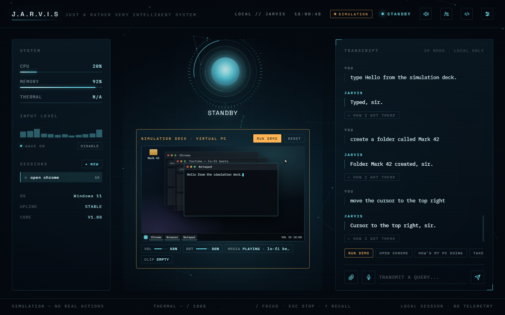
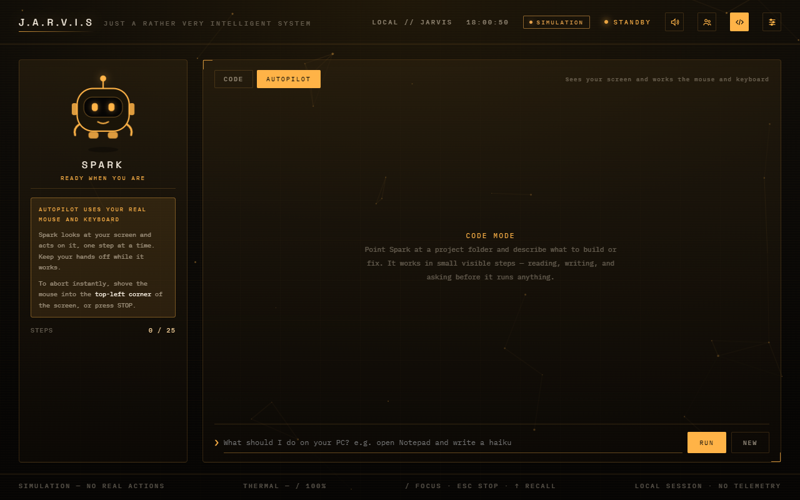

<div align="center">

# J.A.R.V.I.S

**A voice-controlled AI assistant that actually operates your Windows PC.**

Talk to it, type to it, or hand it a goal and watch it work the mouse and keyboard itself.




</div>

## What it does

| | |
|---|---|
| **Voice assistant** | Say "Jarvis" and talk. Neural text-to-speech replies, English or Hindi, with a composed, dry, British personality. |
| **PC control** | Opens and closes apps, websites and folders, controls media, volume, brightness and windows, takes screenshots, reads the screen, locks / sleeps / shuts down. |
| **Autopilot** | Give it a goal. It looks at the screen, moves the pointer, clicks and types — step by step, like a person at the keyboard. |
| **Code mode** | A coding agent (and its mascot, Spark) that builds and edits files inside one project folder, asking before it runs any command. |
| **Simulation mode** | A virtual PC to try all of it on safely. Nothing touches your real machine, and it needs no API key. |
| **Any brain** | Gemini, OpenAI, Anthropic, OpenRouter or a local Ollama model. Add several keys and it falls back automatically. |
| **Extras** | Image generation, Gmail read + draft (never send), long-term memory, chat sessions, a multi-agent discussion room, file attachments. |

Everything runs on your own PC. The interface is a local page served to its own
app window on `127.0.0.1`; the only things that leave the machine are the calls
to the AI provider you chose and the text-to-speech request.

## Quick start

```
pip install -r requirements.txt
python main.py
```

or double-click **`run.bat`**. A window opens. On first run it asks for an API
key and your name — or press **TRY SIMULATION** and skip the key entirely.

To install it like a normal program (Start Menu entry, desktop shortcut,
uninstaller), run `build_installer.bat` once — see
[Building a real .exe / installer](#building-a-real-exe--installer). To have it
start with Windows, switch on **LAUNCH AT STARTUP** in settings.

## Simulation mode

Switch it on in settings (or start in it from the setup screen) and Jarvis
stops touching your real PC. Every action that would have a side effect is
applied to a virtual desktop instead, drawn live in the **Simulation Deck**:
windows open, stack and snap, the cursor glides to where it was sent, typing
appears in the focused window, brightness dims the screen, a screenshot
flashes, a shutdown counts down and can be cancelled.

- **What is simulated:** apps, URLs, YouTube, cursor, clicks, typing, keys,
  volume, mute, brightness, screenshots, lock / sleep / shutdown / restart,
  media and window controls, folders, clipboard, tool installs, saving code
  projects, Gmail (a made-up inbox), image generation (an abstract stand-in,
  no quota spent), and "forget everything" (your real memory is left alone).
- **What stays real:** the time, CPU / RAM readings, history search,
  remembering a fact, and language / profanity settings. They are harmless
  and more useful real.
- **No key needed.** Without an API key, an offline rule-based core
  understands commands ("open chrome", "volume up", "set brightness to 40",
  "snap left", "shut down"). It recognises commands; it does not hold a
  conversation. Add a key and the real model takes over the thinking while
  the actions stay simulated.
- **RUN DEMO** plays a scripted tour through the virtual PC.

Every simulated reply is marked: the task card says SIMULATED, and "How I got
there" shows the mode.

## Autopilot

Open code mode (the `</>` button), pick the **AUTOPILOT** tab, and describe a
goal: *"open Notepad and write a haiku about rain"*, *"find the Wi-Fi settings
page"*. Jarvis minimises its own window, then loops: take a screenshot, send it
to the model, perform the one action that comes back (click, double-click,
right-click, move, type, key, hotkey, scroll, wait), look again.

This drives your **real** mouse and keyboard, so it is boxed in:

- It only runs when you start it, with a goal you wrote.
- **Push the mouse into the top-left corner of the screen to abort instantly.**
  STOP in the Jarvis window also works, before the next action.
- Capped at 30 steps per run, one run at a time.
- The model is instructed not to buy, send, delete, change security settings
  or type passwords unless the goal asks for exactly that.
- It will not run while simulation mode is on.

It needs a model that can see images: the Gemini, OpenAI and Anthropic models
in `config.py` can; most small local Ollama models cannot. How well it does
depends heavily on the model — expect it to be slower than you, and to miss
sometimes. Watch it the first few times.

## Code mode



The **CODE** tab is a coding agent restricted to one project folder you choose.
Describe a task and it works in visible steps — list, read, write — with
each one logged as it happens. Shell commands are never run on their own: each
one is shown to you first with APPROVE / DENY. It refuses a drive root, your
whole user folder, or anything under Windows as the project folder, and it
cannot read or write outside the folder you gave it. Follow-up instructions
continue the same conversation; NEW starts fresh.

In simulation mode it still reads files, but writes and commands become dry
runs.

## Voice

Replies use Microsoft's neural voices through edge-tts (free, no key). Eight to
choose from in settings, plus **VOICE FX**: CLEAN leaves the voice alone, COMMS
adds presence, a faint doubled shimmer and a small room, DEEP drops it lower
and slower. The ring around the orb follows the real audio as it speaks.

## Choosing a model

Jarvis picks the provider from the key you paste. To try a model that is not
in `config.py` yet, put its exact id in **MODEL OVERRIDE** in settings (or set
`JARVIS_MODEL`); it is tried first and the normal list follows if your key
cannot reach it. Very large hosted models are reachable this way through an
OpenRouter key — use the `vendor/model` slug from openrouter.ai/models.

## Tests

```
python -m unittest discover tests
```

Covers the virtual PC, the offline command core, and the autopilot loop (with
the model, screen and mouse replaced by fakes).

## Setup

### 1. Install Python (3.10+) and dependencies
```
pip install -r requirements.txt
```

### 2. Get an API key (or several)
Works with any of these — Jarvis detects which one you gave it automatically:
- **Gemini** (free tier): https://aistudio.google.com/app/apikey
- **OpenAI**: https://platform.openai.com/api-keys
- **Anthropic**: https://console.anthropic.com/settings/keys

Only the Gemini path has had real end-to-end use so far; OpenAI and
Anthropic support is built against each provider's current documented API
and covered by tests, but `llm.py` is the first place to look if something
misbehaves.

**You can add more than one key.** Paste them one per line in the setup box.
If a key runs out of quota, gets revoked, or stops working, Jarvis falls
through to the next one automatically and carries on — and it remembers
which key worked, so it won't waste a request re-trying a dead one every
time. The keys don't have to be from the same provider: an exhausted Gemini
key can fall over to an OpenAI or Anthropic key, each used correctly.

Worth knowing: rate-limit and auth/billing errors trigger the fallback, but
a genuine request error (a bug in the request shape) stops immediately
rather than burning through every key you own for a failure that would
repeat identically on all of them.

### 3. Run it
```
python main.py
```
or double-click **`run.bat`**.

A window opens automatically to the Jarvis interface. **First run only**, it
asks for that API key and your name right there in the interface (not the
console) — you won't be asked again after that.

## How to use it
- **Say "Jarvis"** anytime and it starts listening — no button needed. First
  time, your browser asks for microphone permission; allow it.
- Or click the **mic button** to talk without the wake word.
- Or **type** in the box and hit enter.
- **The mic button doubles as a stop button** — while Jarvis is thinking or
  talking, the same button turns into a stop icon. Click it to cut it off
  mid-sentence and immediately start listening for your next thing, instead
  of waiting for it to finish.
- Try: "open chrome," "play [song] on youtube," "take a screenshot," "how's
  my pc doing," "lock my pc," "remember that I prefer dark mode," "switch to
  Hindi," "tone down the swearing."
- **Speaker icon** mutes spoken replies (text-only). **Settings icon** opens
  language/profanity controls without needing to say them.
- To quit, close the window, or Ctrl+C in the terminal if you ran it from one.

## Playing a specific song / video
"Play [song] on YouTube" opens **YouTube search results** for it — reliably,
in about a second, one click away from playing. It does not click the exact
video for you. If you want that, give the goal to **Autopilot** instead, which
can look at the page and click the thumbnail — slower and less certain than
the one-second search, but it does the whole job.

## Image generation
Say "generate an image of..." / "draw me..." and Jarvis makes one with
Gemini's image model, shows it right in the transcript, and saves a copy to
`%APPDATA%\Jarvis\generated_images\`. Uses `gemini-2.5-flash-image` by
default (`IMAGE_MODEL` in `config.py`) — it's the one with an actual free
tier (~500/day); the newer `gemini-3.1-flash-image` / `gemini-3-pro-image-preview`
look sharper but bill per image with no free tier at all.

**Video generation isn't included** — deliberately, not an oversight. Google's
video models work completely differently from everything else here: you
submit a job and poll for it to finish, often taking **1-6+ minutes** per
clip, versus the few seconds everything else takes. That breaks the
request-and-get-an-answer flow this whole app is built around, and would need
a genuinely different UI pattern (a progress indicator, a way to keep working
while it renders in the background) plus likely tighter/pricier quota than
you're already bumping into on text. Worth building properly as its own
feature if you want it — not as a rushed add-on to this round.

## Code
When an answer includes actual code, it shows up in a proper code box —
monospace, language-labeled, with **COPY** and **OPEN IN TERMINAL** buttons —
instead of being crammed into the spoken reply (which would be unbearable
read aloud).

**Open in Terminal** saves the code to a file and opens a terminal already
sitting in that folder. It deliberately does **not** run it. Jarvis already
has broad control over your PC (cursor, apps, shutdown); stacking "also
auto-executes whatever it writes, unsandboxed" on top of that is a real
safety tradeoff, not a convenience worth taking casually — a bug or a bad
generation would run against your real files and accounts with your full
permissions. Read it, then type the run command yourself.

## Themes
Three options in the settings panel, saved across restarts:
- **Dark** (default) — the cyan HUD look.
- **Light** — same layout, light background, darker accents for contrast.
- **Oppenheimer** — high-contrast red.

The whole interface runs on CSS variables now, so adding your own theme
means copying one `:root[data-theme="..."]` block in `index.html`, changing
the colors, and adding a matching button in the settings panel.

## Installing apps
Ask for an app that isn't installed and Jarvis checks your Downloads folder
for an installer you've already downloaded, then opens it. You still click
through the setup wizard yourself — nothing installs silently, and nothing
gets downloaded from the internet on your behalf. That boundary is
deliberate: "download and run an installer off the web because a voice
command asked for it" is exactly the shape of a bad day.

## Gmail
Ask "what's in my inbox" / "any unread mail" and Jarvis lists it; ask "draft a reply
to [sender] saying [whatever]" and it writes a real draft into your Gmail Drafts
folder. **It never sends anything itself** — the OAuth scope it asks for is
read + compose only, `gmail.send` is deliberately excluded, so a draft is the
furthest it can go. You review it in Gmail and hit send yourself, same boundary as
"Open in Terminal" never running the code it writes.

This is optional — nothing else in Jarvis needs it, and the two Gmail actions just
report "Gmail isn't connected yet" until you set it up. One-time setup, about five
minutes:

1. **Create a Google Cloud project** (free) at
   https://console.cloud.google.com/projectcreate — any name works.
2. **Enable the Gmail API** for that project: search "Gmail API" in the console's
   API Library and click Enable.
3. **Configure the OAuth consent screen** (APIs & Services → OAuth consent screen):
   choose **External**, fill in an app name and your email, and add your own Google
   account under **Test users**. Since this only ever runs for you, it can stay in
   "Testing" mode indefinitely — no Google review needed.
4. **Create an OAuth client** (APIs & Services → Credentials → Create Credentials →
   OAuth client ID): Application type **Desktop app**, any name. Download the
   resulting JSON.
5. **Rename it `gmail_credentials.json`** and put it in `%APPDATA%\Jarvis\`
   (the same folder `jarvis_memory.json` already lives in — create the folder first
   if Jarvis hasn't run yet).
6. **First Gmail command you give Jarvis** opens a real browser tab asking you to
   sign in and approve access — that's Google's own consent screen, not Jarvis's.
   Approve it once and Jarvis caches the login in `%APPDATA%\Jarvis\gmail_token.json`;
   you won't be asked again unless you revoke access from your Google account.

## Memory: two different kinds
- **Short-term (this session)**: Jarvis now actually remembers what you just
  said — "I'm working on a Python project" → "open vscode" connects those,
  instead of every command being treated as an isolated, amnesiac request.
  Resets when you restart the app, same as how a conversation naturally
  resets when you start a new one.
- **Long-term (forever, across restarts)**: your name, remembered facts,
  language, profanity level — saved to `jarvis_memory.json`, covered below.
  Saying "forget everything about me" clears both kinds at once.

## About the personality
Jarvis eases off roasting *you* specifically now, per request — still witty
about situations/ideas elsewhere, just not landing jokes on you personally.
Worth being upfront about the mechanism: this only runs locally for one
person, so there's no real identity check happening — "respect Vansh" in
practice just means "go easier on whoever's actually using this."

## Voice
Replies use Microsoft's edge-tts neural voices (free, no key) instead of the
robotic Windows default, tuned slightly slower and lower (`EDGE_TTS_RATE` /
`EDGE_TTS_PITCH` in `config.py`) for a more measured delivery. **On the movie
JARVIS voice specifically**: that's Paul Bettany's copyrighted voice
performance for Disney/Marvel — not something available through any free TTS
engine, and not something to clone even if it were technically possible.
`en-GB-RyanNeural` (default) and `en-GB-ThomasNeural` are the closest
legitimate British-male options; preview both at https://tts.travisvn.com
and swap `EDGE_TTS_VOICE` in `config.py` if you prefer the other.

## Language and personality
- **English/Hindi**: say "switch to Hindi" / "switch to English," or use the
  settings panel. Hindi replies are Hinglish (Roman letters) by default —
  that's what a fallback English voice can actually pronounce correctly.
- **Profanity**: off / mild / medium / full, in the settings panel or by
  voice ("stop swearing," "you can swear more"). Default is medium.
- **Reply length** adapts to the question — quick commands get quick
  confirmations, real questions (explanations, code, guides) get complete
  answers instead of being clipped to one line. It won't pad short answers
  out, and it won't truncate long ones.

## If you're hitting rate limits despite a paid key
`config.py` has a `PROVIDER_MODELS` list per provider — if the first model
comes back rate-limited, the next one is tried automatically instead of
just failing. Two other things worth checking if limits persist:
- **Billing linkage**: a key can look "paid" while still pointing at an
  unbilled project. Check the *project* the key belongs to in your
  provider's console, not just that a card is on file.
- **Per-model quotas**: newer models often ship with tighter default limits
  than older, more established ones regardless of billing status.
- **Switch providers entirely**: since Jarvis now takes a Gemini, OpenAI, or
  Anthropic key interchangeably, swapping to a different provider's key in
  the setup screen is a one-field fix if one account is throttled.

## System stats
CPU% and RAM% (`psutil`) are reliable everywhere. **CPU temp is best-effort**
— it reads Windows' standard WMI thermal sensor, which a lot of laptop
boards (including plenty of gaming laptops) don't expose. N/A here means
your board, not a bug. [LibreHardwareMonitor](https://github.com/LibreHardwareMonitor/LibreHardwareMonitor)
is the fix if you want real numbers — wiring it in is a natural next step.

## Data storage
Your API key, name, and memory live in `%APPDATA%\Jarvis\jarvis_memory.json`
— not next to the script. This matters once this runs as a packaged .exe (a
script's own folder can be read-only, e.g. under Program Files) and is just
the correct place for per-user app data regardless. Delete that file, or say
"forget everything about me," for a clean slate. If Jarvis ever crashes with
no console visible, check `%APPDATA%\Jarvis\crash_log.txt`.

## Building a real .exe / installer
```
build_installer.bat
```
Run this once, on your own Windows PC (it needs to actually compile there —
I can't hand you a working .exe from this sandbox, only the tooling to build
one correctly yourself). It:
1. Installs PyInstaller if needed and bundles everything into a single
   `dist\Jarvis.exe` — no console window, no visible Python.
2. If you have [Inno Setup](https://jrsoftware.org/isdl.php) (free) installed,
   also builds `installer_output\JarvisSetup.exe` — a real installer with
   Start Menu and Desktop shortcuts and a proper uninstaller.

Without Inno Setup, step 1 alone already gives you a real, working,
double-clickable app — step 2 is the extra "looks like a downloaded,
installed program" polish.

## Customizing
- **Add/fix an app**: edit `APP_PATHS` in `config.py` — but you often don't
  need to. If you ask for an app that isn't in that list, Jarvis now
  searches your actual Windows Start Menu shortcuts for a match before
  giving up, the same way typing into the Start Menu search box would. Add
  to `APP_PATHS` for anything that still doesn't resolve, or to guarantee a
  specific one always wins over Start Menu search.
- **Change the personality**: edit `SYSTEM_PROMPT` in `brain.py`.
- **Change the port**: edit `SERVER_PORT` in `config.py` if `8731` collides
  with something else on your PC.

## Safety notes
- `shutdown_pc` / `restart_pc` wait 10 seconds before happening — say "cancel
  shutdown" during that window to stop it.
- `close_app` force-quits (`taskkill /F`) — save your work first.

## Troubleshooting
- **A request comes back "Cross-site requests are not allowed"** → the local
  API only answers the Jarvis window itself. Open the app at
  `http://127.0.0.1:8731` (or `localhost:8731`), not through another address.
- **Voice input does nothing** → speech recognition needs a real Chrome/Edge
  engine. `main.py` launches one directly for you; if that somehow fails and
  it falls back to a different default browser, open `http://127.0.0.1:8731`
  manually in Chrome or Edge instead.
- **Mic permission popup never appeared** → check that browser's site
  settings for `127.0.0.1:8731` and allow microphone access manually.
- **"model not found" error** → edit `PROVIDER_MODELS` in `config.py` for
  whichever provider you're using.
- **Port already in use** → change `SERVER_PORT` in `config.py`.
- **Nothing happens right after launch, or it looks like it opened then
  closed** → check `%APPDATA%\Jarvis\crash_log.txt` (packaged .exe) or the
  console output (running from source).

## Ideas to take this further
- Starting Autopilot by voice from the main console, and letting it ask a
  question mid-run instead of stopping.
- LibreHardwareMonitor integration for real GPU/CPU temps.
- A proper Devanagari Hindi voice once a Hindi voice pack is installed in
  Windows Settings, routed through the local SAPI voice for Hindi mode
  instead of edge-tts.
